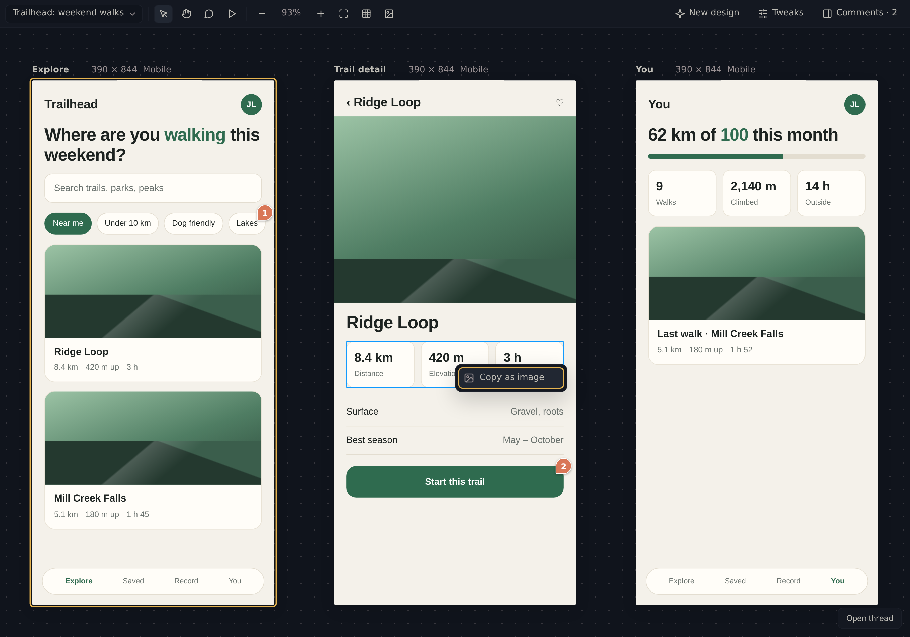
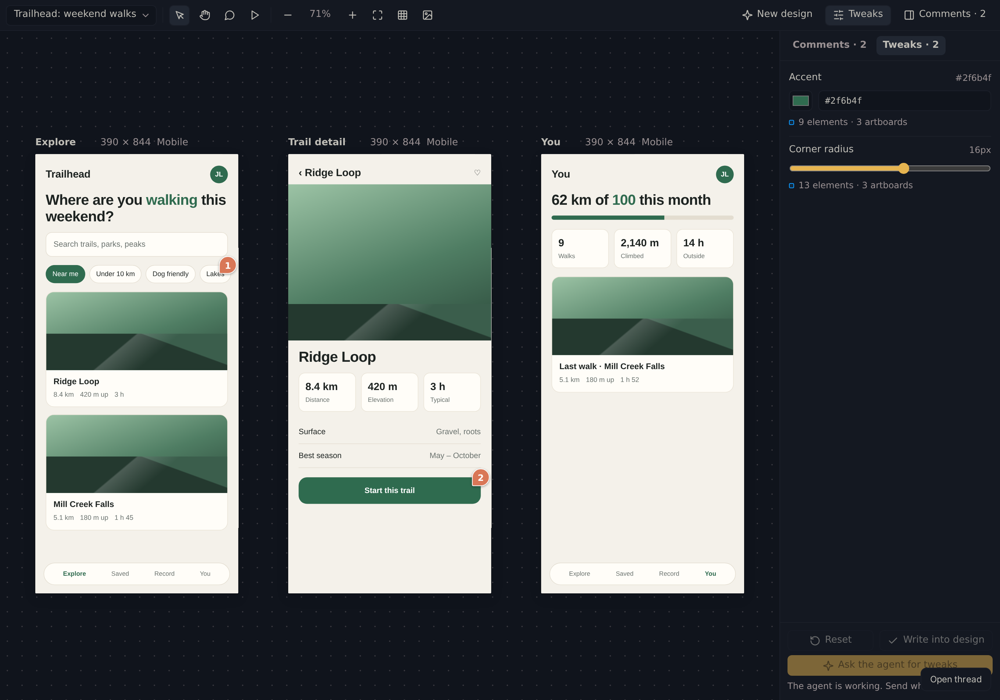

# Design canvas for bb

Where you and an agent design together. The agent draws designs as HTML artboards. You look at them side by
side, move elements, fix text, tune values, point at what should change, and the agent revises. Designs are
plain files in the workspace's `design/` folder.


## Credit

**This plugin is the work of [961853266hyt](https://github.com/961853266hyt).** It is a port of their
**[Design canvas](https://paseo.sh/plugins/961853266hyt/design-canvas) plugin for paseo** (version 0.4.0, source in
[961853266hyt/paseo-plugins](https://github.com/961853266hyt/paseo-plugins), `plugins/design-canvas`).

The idea, the interaction design and nearly all of the code are theirs: the canvas, the in-frame runtime, the
design store, the HTML patching, comments, tweaks, the zip import and export, and the agent tools. They are kept
as they were wherever bb allowed. This port adds a bb host layer around their work, plus copy as image (below).
If you like this plugin, the credit goes to them: star their repository and try the original in
[paseo](https://paseo.sh).

Used under the MIT license. The original copyright notice is in [LICENSE](LICENSE), and this port is
distributed under the same terms.

## Using it

- **Design tab.** Open a thread's right panel and choose Design (palette icon), or run "Open the design canvas"
  from the command palette.
- **Design home.** The Design page in the sidebar, or "Open the Design home" from the command palette. Start a
  design (prototype, wireframe or other), pick the project, describe it and press ↑: a new thread draws it while
  its chat and canvas open. Recent designs from every project are below; click one to open it at full size on
  its own page. A zip dropped on the screen is imported.
- **Existing designs from other projects.** A thread only sees its own workspace's folder. The empty canvas and
  the design menu also list the designs of your other projects, with a way back to this workspace.
- **`/canvas`.** `/canvas <what to design>` has the agent draw it. A bare `/canvas` has the agent open the
  canvas beside the chat. bb has no plugin slash commands, so this is a skill, not a command.

On the canvas:

- **Move** (V) selects the nearest element the agent named and drags it; arrow keys nudge it 1 px, 10 px with
  Shift. Drag an artboard by its title. Double-click text to edit it in place. Ctrl/Cmd+Z undoes, Ctrl/Cmd+Shift+Z
  redoes.
  Clicking an artboard's title selects the artboard (it no longer centres the view in Move); Shift-click adds or
  removes artboards and elements, across artboards. Escape or a click on the empty canvas clears the selection.
  **Copy as image** (right-click an artboard, its title or an element) puts the selection on the clipboard as one
  PNG at 2x: one item alone, or several placed as they sit on the canvas on a transparent background. The toolbar's
  **Copy canvas as image** does the same for every artboard. Very large images are scaled down to fit the
  browser's canvas limit, and the toast says so. On a plain-http address, where the browser has no image
  clipboard, the image opens in a preview instead: right-click it and choose Copy Image.

  
- **Hand** (H) pans with a drag anywhere; hold Space for it in any tool. **Preview** (P) follows links between
  artboards. **Comment** (C) highlights the element under the pointer; click to comment, Alt+click for the exact
  element, Ctrl/Cmd+Enter to add.
- Comments wait as numbered pins until you press **Send to the agent**, which sends them in one message. The
  agent resolves each with a line on what it changed.
- **Tweaks** shows the controls the agent declared, each driving a CSS variable. Every artboard follows as you
  drag, and the values are saved to `tweaks.css`.

  
- Zoom with Ctrl/Cmd+scroll or the buttons, fit with Ctrl/Cmd+0, layout grid with Shift+G. Zoomed out, an
  artboard's label shortens to the artboard's width and shows in full on hover.
- A design's ⋯ menu renames, exports (zip) or deletes it. A deleted design moves to `design/.trash/`.

## Agent tools

`design_create`, `design_list`, `design_read`, `design_resolve_comments` and `design_set_tweaks`, as in the
original, plus `design_open`, which brings the canvas up beside the chat for `/canvas`.

They attach when a thread's session starts, to threads the Design home started and to threads in a workspace that
already has `design/canvas.json`, and only on the machine bb runs on. In other threads the agent works from
`design/README.md` and the files, and writes comment resolutions into `comments.json` itself.

## Files

Everything is under `design/` in the workspace, in the original's layout:

- `design/<name>/design.json`: the artboards (id, title, HTML file, width, optional height and group) and tweaks.
- `design/<name>/<artboard>.html`: one self-contained page per artboard.
- `design/<name>/comments.json`, `tweaks.json`, `tweaks.css`: comments and the tweak values you set.
- `design/README.md`: the conventions for agents. `design/canvas.json`: marks the workspace and records which
  thread made each design.

A design made with the paseo plugin opens here as it is.

## What differs from the original

The canvas the user sees is the original's. Where bb needed something else:

- **Host layer, rewritten for bb:** `app.tsx`, `server.ts`, `server/handlers.ts` (the same RPCs on bb's RPC, plus
  five for threads), `server/workspace.ts` (a bb environment, or a project's folder, is the workspace),
  `server/agent-tool.ts`, `shared/define.ts`, `client/panel.tsx`, `client/open.ts`, `client/rpc.ts`, and
  `client/home.tsx` and `client/thumbnail.tsx` (React Native to DOM). paseo's `client/start.ts` is gone; its
  work is in the RPCs.
- **Added:** `client/page.tsx` (a design at full size), `client/api.ts` and `client/canvas-host.ts` (the shared
  glue between the canvas and bb).
- **Added in this port, not in the original:** selecting artboards and several elements in Move, and copy as
  image (right-click menu, the toolbar's whole-canvas copy, and the preview on plain-http addresses), in
  `client/canvas.ts`, `client/runtime.ts`, `shared/runtime-protocol.ts`, with tests in `test/copy-image/`.
- **Small changes inside the original's code:** `client/canvas.ts`, `client/runtime.ts` and `client/styles.ts` (artboard labels that
  fit the artboard, and the other workspaces' designs in the menu and on the empty card), `client/styles.ts`
  (bb's theme variables instead of paseo's colors), `client/i18n.ts`, `client/icons.ts` and the two locale files
  (bb wording, a few new strings and icons), `server/tools.ts` and `server/guide.ts` (bb wording), and
  `server/store.ts` (the guide it refreshes is the bb one; a README written by the paseo plugin is left alone).
- Everything else in `client/`, `server/` and `shared/` is byte-identical to version 0.4.0.

## Limits

- Only elements with a `data-dc-id` can be moved. Text is edited one run at a time; text inside SVG or written by
  a script can't be edited in place.
- Fonts, images and scripts from a CDN are blocked; keep them in the workspace.
- It reads and writes the workspace folder directly, so it works on workspaces on the machine bb runs on.
- Each artboard runs in a sandboxed frame with no access to bb, and a content security policy stops the page
  loading anything from the network. A design's own code can still reach the network by navigating its frame, or
  through markup placed before `<head>`. Open only designs you trust.

## Development

```bash
npm install
npx tsc --noEmit
bb plugin build .
bb plugin install .
```

Requires bb 0.49 or later.
